<p align="center">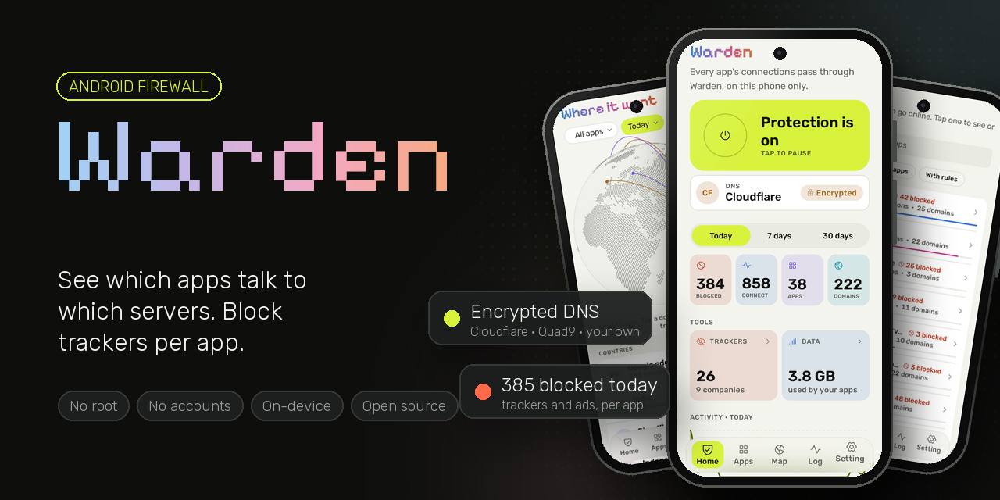</p>

<h1 align="center">Warden</h1>

<p align="center">
  A free, open-source firewall for Android that needs no root.<br>
  See which apps talk to which servers, block any app or tracker. Everything stays on your phone.
</p>

<p align="center">
  <a href="https://github.com/sammyZi/warden/releases/latest"><b>⬇️ Download the latest APK</b></a>
  &nbsp;·&nbsp;
  <a href="https://github.com/sammyZi/warden/releases">All releases</a>
  &nbsp;·&nbsp;
  <a href="#privacy-promise">Privacy promise</a>
</p>

<p align="center">
  <a href="https://github.com/sammyZi/warden/releases/latest"></a>
  
  
  
  
  <a href="LICENSE"></a>
  
  
  
  <br>
  <a href="https://github.com/sammyZi/warden/releases"></a>
</p>

<!-- Demo GIF goes here: an app contacting trackers, then a blocked connection. -->

## Features

**Block what you want**
- **Cut any app off the internet**, separately on Wi-Fi and mobile data. Every installed app is listed, so you can block one before it ever connects.
- **Block or allow single domains**, for one app or for every app, straight from the live log, the app's page or the map.
- **Blocklists** for ads, trackers and malware (HaGeZi, StevenBlack, OISD), downloaded and refreshed on your phone.
- **Skip Warden** for apps you trust, so their traffic doesn't go through it at all.
- **No sneaking around it**: apps can't dodge your rules with their own DNS servers, DNS-over-HTTPS or DNS-over-TLS.

**See what your apps do**
- **Live log** of every lookup and connection, with the app, time, and whether it was blocked.
- **Where it went**: a 3D globe of the countries your traffic reached, filtered by app, time span, blocked or trackers. CDN edges are labelled as such.
- **Per-app pages**: connections, domains, trackers, recent activity, data used and a shortcut to that app on the map.
- **Tracker companies**: "your apps contacted 26 trackers from 9 companies today", grouped by company and purpose.
- **Privacy report cards**: an A–F grade per app with the working shown, shareable as an image.
- **Data usage per app**, split by Wi-Fi and mobile, even while Warden is off (with Android's Usage access).
- **30 days of history** stored on your phone, with Today / 7 days / 30 days views.

**DNS and network**
- **Encrypted DNS**: send lookups to Cloudflare, Quad9 or your own DNS-over-HTTPS server, so your Wi-Fi or carrier can't read them.
- **Private DNS warning** when Android's own setting would bypass Warden, with a link to fix it.
- **Survives network changes**, rebuilding itself when you move between IPv4-only and IPv6 networks.

**Built to be light and private**
- No account, no analytics, no ads, no cloud. Nothing about your traffic leaves the phone.
- Screens pause their work in the background and history is written in batches, to keep battery use low.

## Screenshots

| Home | Apps | App detail |
|:---:|:---:|:---:|
| 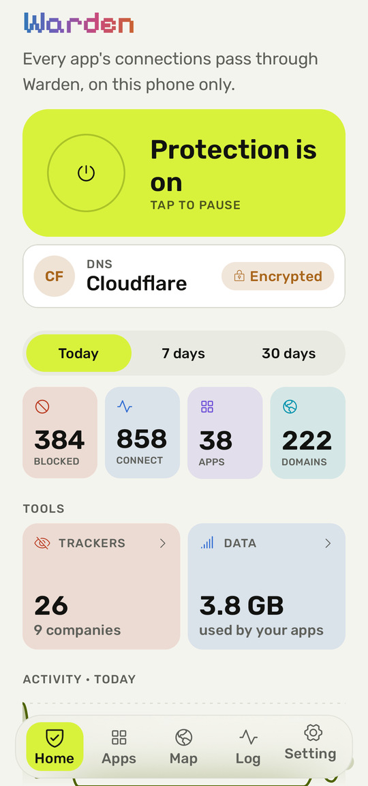 | 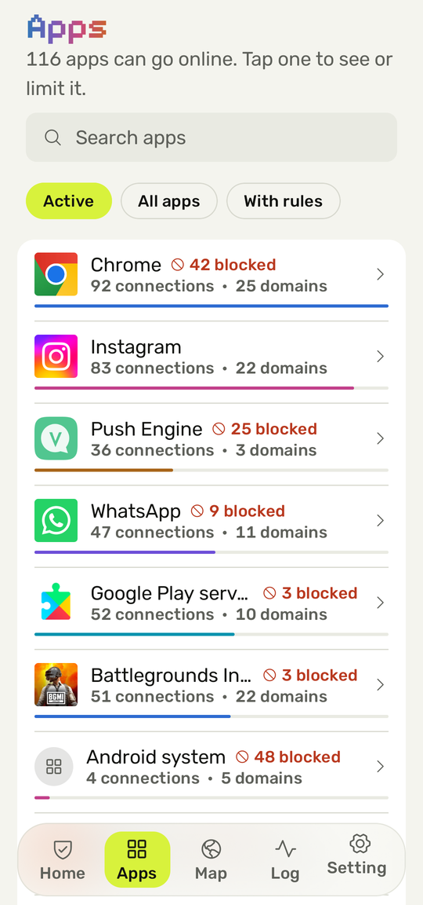 | 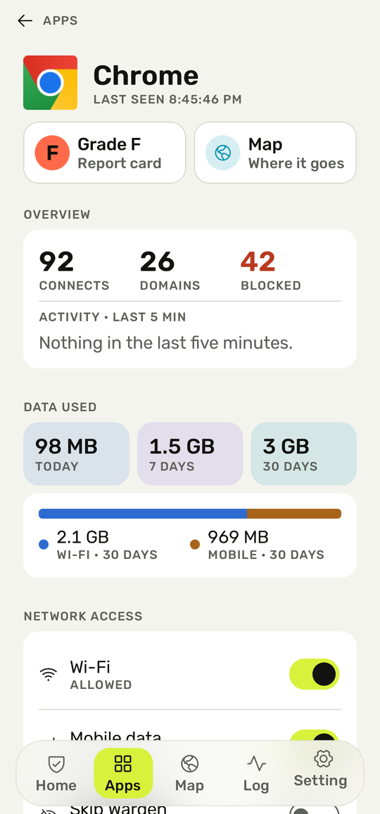 |
| **Where it went** | **Live log** | **Data** |
| 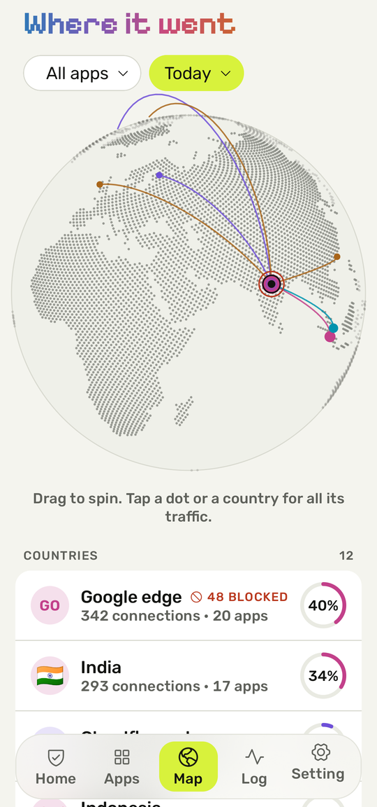 | 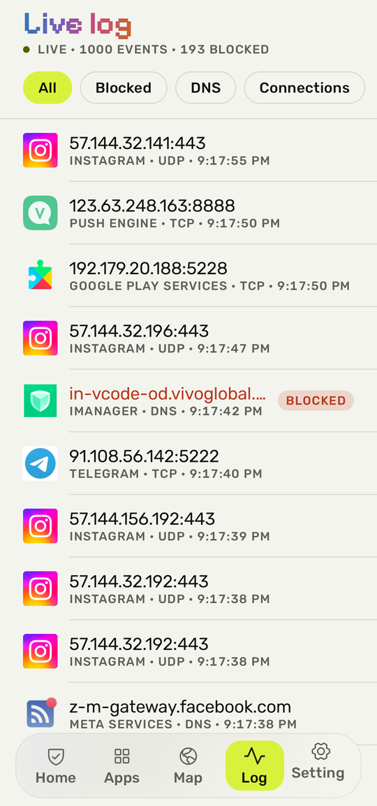 | 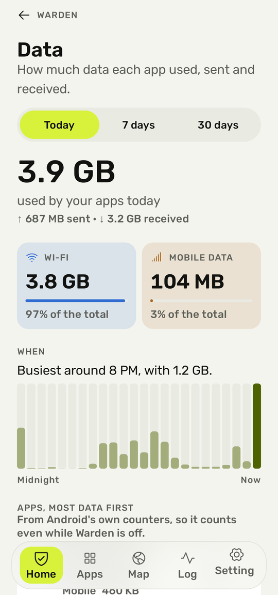 |
| **Trackers** | **Report card** | **Settings** |
| 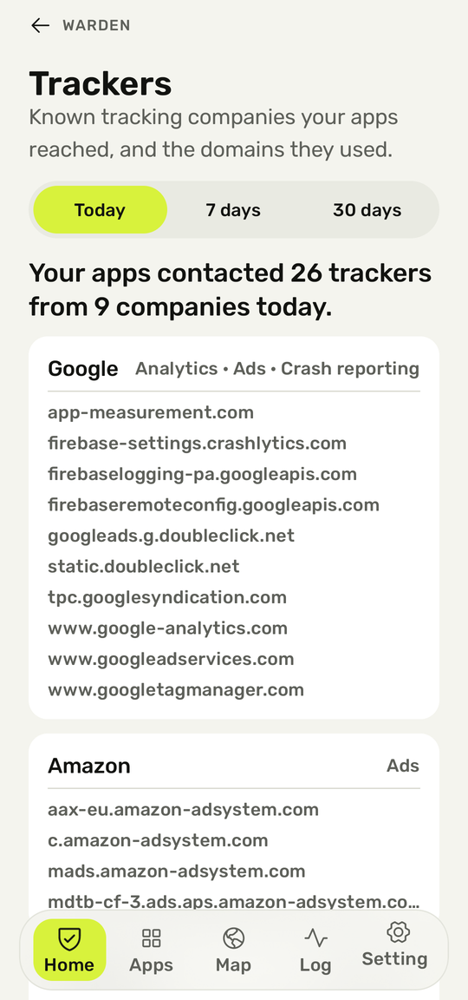 | 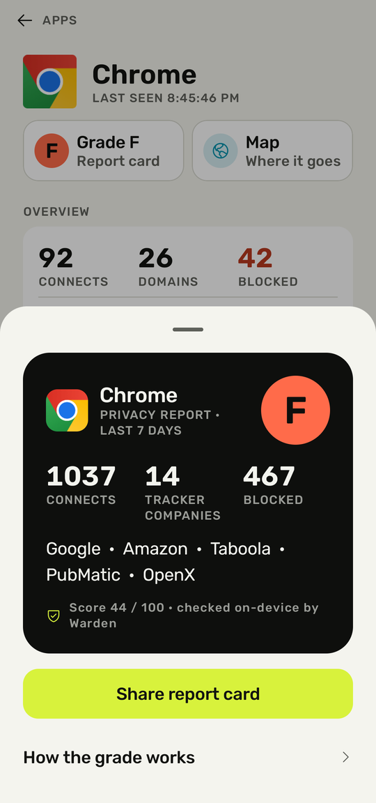 | 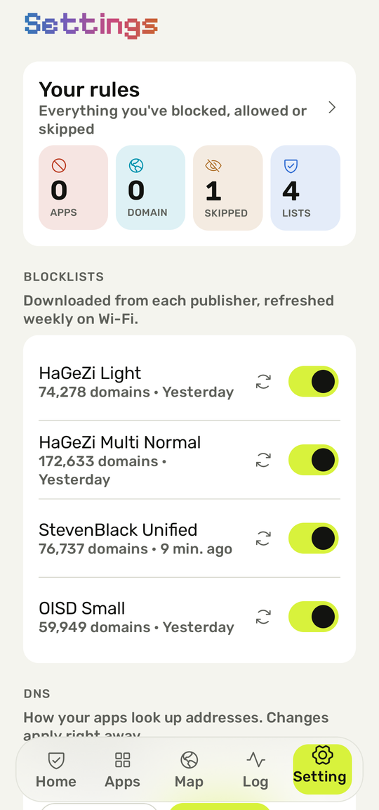 |

The banner and these images are generated from real device captures by `tools/banner/make_banner.py`.

## How it works

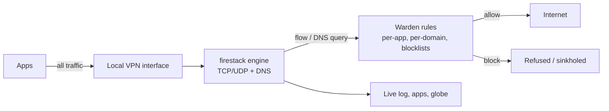

1. Android routes app traffic into a virtual network interface that Warden owns. Nothing is sent to
   a remote server: it is a *local* VPN.
2. The [firestack](https://github.com/celzero/firestack) engine (MPL-2.0) runs the TCP/IP stack and
   DNS, and asks Warden about every DNS query and every new connection.
3. Warden decides with one precedence order: your per-app rule for that domain, then the app's
   Wi-Fi/mobile rule, then your global rule, then your enabled blocklists, then allow.
4. Blocked lookups are sinkholed and blocked connections refused. Everything else goes out as normal.

## Privacy promise

- No account, no analytics, no crash reporting, no ads, no cloud.
- Warden's own network calls are only the ones you switch on: blocklist downloads, and lookups to the
  encrypted DNS server you pick.
- Warden never decrypts HTTPS. It sees *where* apps connect (domain, IP, port), never *what* they send.
- IP-to-country lookups use an offline database bundled in the app. History stays on the phone and can
  be cleared from Settings.

## Honest limitations

- **No HTTPS inspection**, by design. Warden sees destinations, not content.
- **One VPN at a time.** Android allows a single VPN app, so Warden can't run alongside another VPN.
- **Encrypted Client Hello (ECH)** will gradually hide the domain in TLS handshakes; DNS-based
  blocking still works, but some connections will only show an IP.
- **Strict Private DNS** (a hostname set in system settings) bypasses Warden's DNS. The app detects
  it and shows how to switch to Automatic or Off.
- **Aggressive battery savers** (Xiaomi, Oppo, vivo, Samsung and others) can kill background apps.
  Set Warden's battery usage to Unrestricted; onboarding links to the setting.
- Locations are country-level and approximate; anycast services often answer from a nearby server.

## How Warden differs from Rethink and TrackerControl

[Rethink](https://github.com/celzero/rethink-app) and [TrackerControl](https://github.com/TrackerControl/tracker-control-android)
are mature, capable tools, and Warden stands on Rethink's engine. Warden's focus is different:

- **Explainability first.** Plain sentences ("Chrome made 42 connections to 18 domains; 2 were
  blocked") instead of raw tables.
- **A modern, calm UI**: per-app detail with expandable domains, a live globe with per-app filtering,
  and one-tap rules from anywhere a domain appears.
- **Small, documented codebase** meant to be read and contributed to.

## Build

Requirements: JDK 17, Android SDK with platform 37.

```bash
./gradlew assembleDebug        # debug APK
./gradlew assembleRelease      # optimized APK (debug-signed unless release signing env vars are set)
./gradlew detekt testDebugUnitTest
```

Release signing uses `WARDEN_KEYSTORE`, `WARDEN_KEYSTORE_PASSWORD`, `WARDEN_KEY_ALIAS` and
`WARDEN_KEY_PASSWORD`. See `.github/workflows/release.yml`.

## Contributing

See [CONTRIBUTING.md](CONTRIBUTING.md) and the [Code of Conduct](CODE_OF_CONDUCT.md).
Good first issues are listed in [docs/good-first-issues.md](docs/good-first-issues.md).

## Roadmap

- Learning mode: suggestions like "Instagram contacted 3 trackers this week; block them?"
- Screen-off blocking and new-app alerts
- Quick Settings tile, home-screen widget and scheduled rules
- Backup and restore of rules
- Optional per-app Tor routing through Orbot

## License

GPL-3.0. See [LICENSE](LICENSE). Third-party components and data are listed in
[docs/licenses.md](docs/licenses.md).
