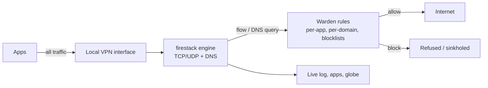

# Warden

**See every server every app talks to. Block trackers per app. No root, no account, no cloud.**

<!-- Demo GIF goes here: an app contacting trackers, then a blocked connection. -->

Warden is an open-source firewall for Android. It uses Android's local VPN slot to watch each
connection your apps make, shows where they go on a live globe, and blocks trackers per app.
Everything happens on your phone.

## Screenshots

<!-- Home · Apps · App detail · Globe · Live log · Settings -->

## How it works



1. Android routes app traffic into a virtual network interface that Warden owns. Nothing is sent to
   a remote server: it is a *local* VPN.
2. The [firestack](https://github.com/celzero/firestack) engine (MPL-2.0) runs the TCP/IP stack and
   DNS, and asks Warden about every DNS query and every new connection.
3. Warden decides with one precedence order: your per-app rule for that domain, then the app's
   Wi-Fi/mobile rule, then your global rule, then your enabled blocklists, then allow.
4. Blocked lookups are sinkholed and blocked connections refused. Everything else goes out as normal.

## Privacy promise

- No account, no analytics, no crash reporting, no cloud.
- The only network calls Warden makes itself are blocklist downloads you switch on.
- Warden never decrypts HTTPS. It sees *where* apps connect (domain, IP, port), never *what* they send.
- IP-to-country lookups use an offline database bundled in the app.

## Honest limitations

- **No HTTPS inspection**, by design. Warden sees destinations, not content.
- **One VPN at a time.** Android allows a single VPN app, so Warden can't run alongside another VPN.
- **Encrypted Client Hello (ECH)** will gradually hide the domain in TLS handshakes; DNS-based
  blocking still works, but some connections will only show an IP.
- **Strict Private DNS** (a hostname set in system settings) bypasses Warden's DNS. The app detects
  it and shows how to switch to Automatic or Off.
- **Aggressive battery savers** (Xiaomi, Oppo, vivo, Samsung and others) can kill background apps.
  Set Warden's battery usage to Unrestricted; onboarding links to the setting.
- Locations are country-level and approximate; anycast services often answer from a nearby server.

## How Warden differs from Rethink and TrackerControl

[Rethink](https://github.com/celzero/rethink-app) and [TrackerControl](https://github.com/TrackerControl/tracker-control-android)
are mature, capable tools, and Warden stands on Rethink's engine. Warden's focus is different:

- **Explainability first.** Plain sentences ("Chrome made 42 connections to 18 domains; 2 were
  blocked") instead of raw tables.
- **A modern, calm UI**: per-app detail with expandable domains, a live globe with per-app filtering,
  and one-tap rules from anywhere a domain appears.
- **Small, documented codebase** meant to be read and contributed to.

## Build

Requirements: JDK 17, Android SDK with platform 37.

```bash
./gradlew assembleDebug        # debug APK
./gradlew assembleRelease      # optimized APK (debug-signed unless release signing env vars are set)
./gradlew detekt testDebugUnitTest
```

Release signing uses `WARDEN_KEYSTORE`, `WARDEN_KEYSTORE_PASSWORD`, `WARDEN_KEY_ALIAS` and
`WARDEN_KEY_PASSWORD`. See `.github/workflows/release.yml`.

## Contributing

See [CONTRIBUTING.md](CONTRIBUTING.md) and the [Code of Conduct](CODE_OF_CONDUCT.md).
Good first issues are listed in [docs/good-first-issues.md](docs/good-first-issues.md).

## Roadmap

- Room-backed history with batched writes and auto-pruning
- Tracker-company mapping ("14 trackers from 6 companies")
- Shareable privacy report cards with a documented A–F grade
- DNS settings: upstream DoH, block response, DoH-bypass blocking
- Scheduled rules, learning mode, PCAP export

## License

GPL-3.0. See [LICENSE](LICENSE). Third-party components and data are listed in
[docs/licenses.md](docs/licenses.md).
